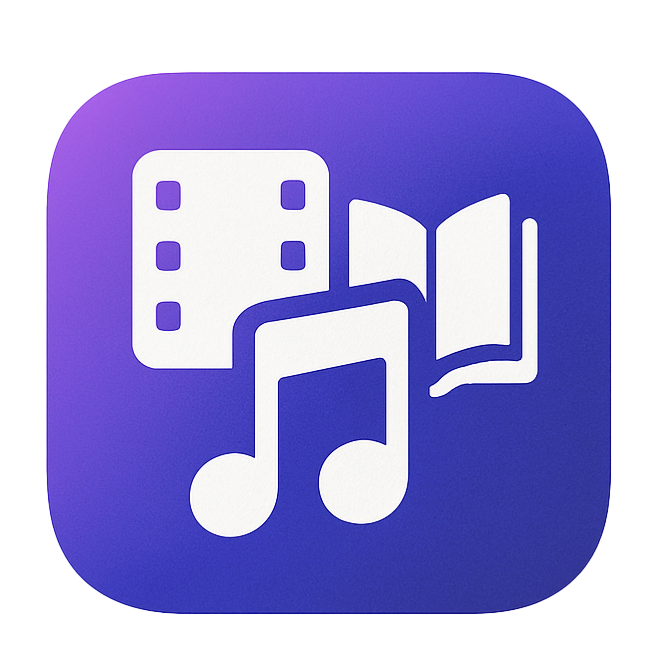
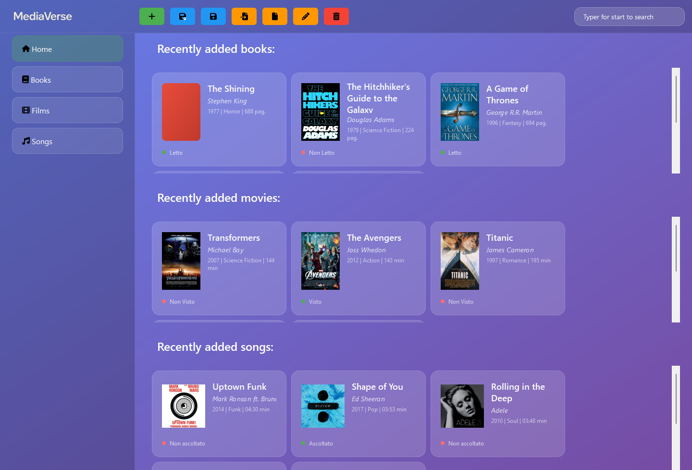
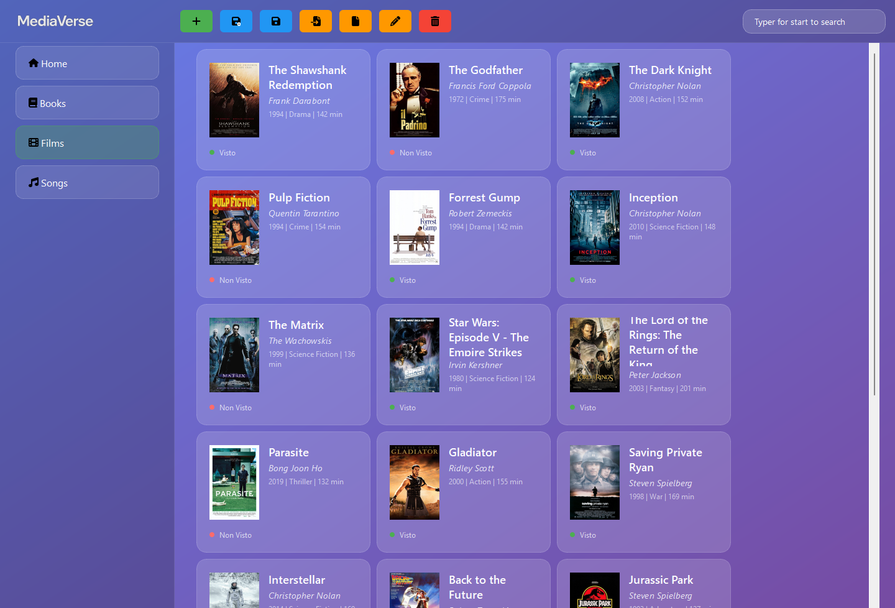
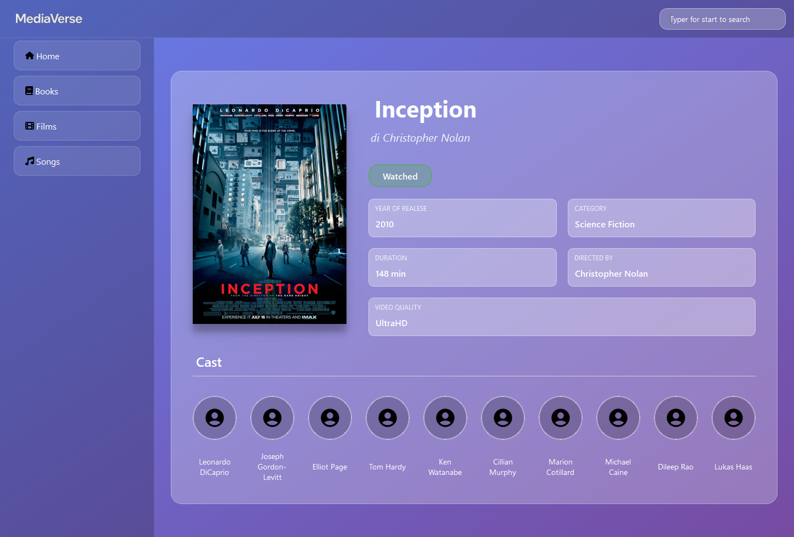
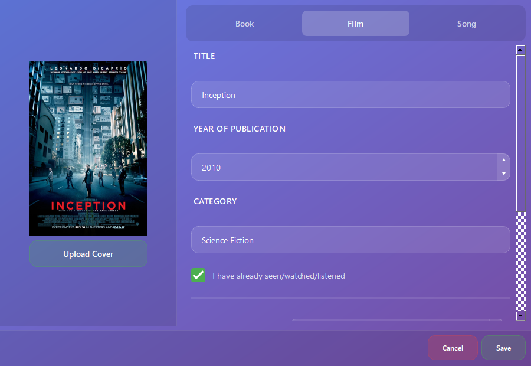

<div align="center">



<br />


### Gestore multimediale desktop per collezionare e tracciare Libri, Film e Brani Musicali

[](https://isocpp.org/)
[](https://www.qt.io/)
[](#compilazione-ed-esecuzione)
[](#architettura-e-design-pattern)
[](doc/CIRIGLIANO%20FRANCESCO.txt)

*Progetto sviluppato per il corso di **Programmazione ad Oggetti (PAO)** — Laurea in Informatica (Giugno 2025)*

[Screenshot](#galleria-screenshot) •
[Caratteristiche](#caratteristiche-principali) •
[Modello dei Dati](#modello-dei-dati) •
[Architettura e Pattern](#architettura-e-design-pattern) •
[Struttura del Progetto](#struttura-del-progetto) •
[Compilazione](#compilazione-ed-esecuzione) •
[Documentazione ed Esito](#documentazione-ed-esito)

</div>

---

## Panoramica

**MediaVerse** è un'applicazione desktop scritta in **C++** con il framework grafico **Qt** che consente di organizzare, catalogare e tracciare la propria collezione multimediale personale. Permette di creare, modificare, eliminare, cercare e contrassegnare come completati tre tipi di contenuti multimediali: **Libri**, **Film** e **Brani Musicali**.

Il progetto è stato progettato ponendo particolare attenzione alla **qualità architetturale**, all'**estensibilità** e al **disaccoppiamento**:
- Il **modello logico** è scritto interamente in C++ standard (`std::string`, `std::vector`) ed è completamente indipendente da Qt.
- Il polimorfismo è sfruttato in modo estensivo tramite il design pattern **Visitor** (`Visitor` e `ConstVisitor`), evitando l'uso improprio di `dynamic_cast` nella generazione della GUI, nel filtraggio, nel popolamento degli editor e nella serializzazione JSON.

---

## Galleria Screenshot

<div align="center">
  
  <p><em>Schermata <b>Home</b> — Panoramica degli ultimi libri, film e brani musicali aggiunti, con stato di fruizione e fallback grafico a gradiente per le copertine mancanti.</em></p>
</div>

<br />

| Vista Filtrata per Categoria (`Grid` + `Card`) | Vista Dettagliata (`Full`) |
| :---: | :---: |
|  |  |
| *Catalogo filtrato per categoria (**Films**) generato tramite `FilterRender` e `Grid`.* | *Pagina di dettaglio completa generata dinamicamente dal visitor `Full`.* |

<br />

<div align="center">
  
  <p><em>Finestra <b>EditWidget</b> — Creazione e modifica di un media con anteprima della copertina e campi dinamici per tipo (popolati tramite i visitor <code>MediaInjector</code> e <code>TypeSelector</code>).</em></p>
</div>

---

## Caratteristiche Principali

### Gestione della Collezione e Persistenza
- **Operazioni CRUD complete**: creazione, visualizzazione (in scheda sintetica o pagina dettagliata), modifica ed eliminazione di `Book`, `Film` e `Song`.
- **Persistenza in formato JSON**:
  - **Salva con nome**: esportazione dell'intera collezione su un nuovo file `.json`.
  - **Salva**: aggiornamento rapido del file JSON attualmente aperto.
  - **Collezione in memoria**: possibilità di iniziare una nuova collezione da zero senza dover creare preventivamente un file su disco, con avvisi di sicurezza in caso di modifiche non salvate.
- **Dataset di esempio incluso**: il repository include un ricco dataset preconfigurato (`src/dataset.json`) con oltre 30 contenuti multimediali e relative copertine in `src/dataset/`.
- **Gestione automatica degli ID**: assegnazione di identificatori univoci e progressivi gestita dal `Controller` per prevenire collisioni tra media omonimi.

### Ricerca e Navigazione
- **Ricerca avanzata case-insensitive** per corrispondenze parziali sul titolo con doppia modalità di interazione:
  1. **Autocompletamento istantaneo**: suggerimenti in tempo reale durante la digitazione nella barra di ricerca, con apertura diretta della vista dettagliata tramite doppio click.
  2. **Ricerca esplicita a griglia**: premendo `Invio` vengono visualizzate tutte le card corrispondenti nella griglia principale.
- **Filtro per categoria**: barra laterale di navigazione (gestita tramite `QStackedWidget`) per esplorare l'intera libreria o filtrare istantaneamente solo *Libri*, *Film* o *Brani Musicali*.

### Interfaccia Grafica (GUI)
- **Stile moderno personalizzato tramite QSS**: fogli di stile dedicati (`style.qss`, `detailed_style.qss`, `edit_style.qss`) e icone vettoriali SVG.
- **Tracciamento stato di fruizione**: badge visivo su ogni card che indica se il libro è già stato letto, il film guardato o il brano ascoltato.
- **Fallback grafico intelligente**: generazione automatica di gradienti di colore qualora l'immagine di copertina di un media non sia presente o non sia valida.
- **Selezione univoca e controlli contestuali**: gestione centralizzata della selezione della card attiva e abilitazione/disabilitazione dinamica dei pulsanti (*Modifica*, *Salva*, *Elimina*) per prevenire operazioni non valide su collezioni vuote.

---

## Modello dei Dati

Alla base della gerarchia si trova la classe astratta pura `Media::AbstractMedia`, da cui derivano tre classi concrete (`Book`, `Film` e `Song`). Lo schema UML completo del modello è consultabile nel file [`doc/Modello_Logico.png`](doc/Modello_Logico.png).

| Classe | Attributi Comuni (`AbstractMedia`) | Attributi Specifici | Note Progettuali |
| :--- | :--- | :--- | :--- |
| **`Book`** | `id`, `title`, `releaseYear`, `image_path`, `category`, `completed` | `author` (`std::string`)<br>`description` (`std::string`)<br>`pages` (`unsigned int`)<br>`editor` (`std::string`)<br>`ISBN` (`std::string`) | Rappresenta un volume cartaceo o digitale con metadati editoriali completi. |
| **`Film`** | `id`, `title`, `releaseYear`, `image_path`, `category`, `completed` | `videoQuality` (`enum quality: HD, FullHD, UltraHD`)<br>`director` (`std::string`)<br>`duration` (`unsigned int`, min)<br>`actors` (`std::vector<std::string>`) | Gestisce il cast come collezione dinamica di attori. |
| **`Song`** | `id`, `title`, `releaseYear`, `image_path`, `category`, `completed` | `audioFormat` (`enum format: MP3, WAW, FLAC`)<br>`author` (`std::string`)<br>`album` (`std::string`)<br>`duration` (`unsigned int`, sec)<br>`bitrate` (`double`)<br>`lossless` (`bool`) | Il flag `lossless` viene determinato automaticamente dal metodo `setLossLess()` in base al formato selezionato (`WAW` / `FLAC`). |

---

## Architettura e Design Pattern

Il software adotta il pattern architetturale **Model-View-Controller (MVC)** combinato con diversi design pattern classici per massimizzare modularità e manutenibilità (vedi lo schema del modello logico in [`doc/Modello_Logico.png`](doc/Modello_Logico.png) e il dettaglio progettuale in [`doc/Relazione.pdf`](doc/Relazione.pdf)).

### Principali Design Pattern Implementati

1. **Model-View-Controller (MVC)**
   - **Model (`Media::*`)**: incapsula i dati e le regole di dominio senza alcuna dipendenza da Qt.
   - **View (`View::*`)**: gestisce la presentazione visuale e cattura gli eventi dell'utente, delegando le azioni al Controller tramite il meccanismo *Signals & Slots* di Qt.
   - **Controller (`Controller::Controller`)**: coordina l'interazione tra il repository dei dati, le viste filtrate, la ricerca e le finestre di modifica.

2. **Visitor Pattern (`Visitor` & `ConstVisitor`)**
   Il polimorfismo sulla gerarchia `AbstractMedia` è implementato tramite doppia spedizione (*double dispatch*) con `accept(Visitor&)` e `accept(ConstVisitor&) const`. I visitor concreti sono:
   - `View::MediaRender::Card`: costruisce la card compatta con copertina, titolo, anno e indicatore di completamento per la vista a griglia.
   - `View::MediaRender::Full`: genera la schermata di dettaglio completa con tutti gli attributi specifici di `Book`, `Film` o `Song`.
   - `View::MediaRender::FilterRender`: smista una collezione eterogenea di `AbstractMedia*` in liste tipizzate per popolare le viste filtrate per categoria.
   - `Media::Converter::Json::JsonVisitor`: serializza ogni oggetto concreto in un `QJsonObject` aggiungendo il discriminatore `"type"`.
   - `View::ItemEditor::MediaInjector`: popola i campi dell'editor corretto quando un elemento esistente viene aperto in modalità modifica.
   - `View::TypeSelector`: sincronizza il selettore del tipo di media nell'interfaccia di editing.

3. **Repository & Data Mapper Pattern**
   - `Media::Repository::MRepository` / `JsonRepository`: astrae la gestione in memoria della collezione (CRUD) dalla logica di persistenza su file.
   - `Media::DataMapper::JsonFile` & `Media::Converter::Json::*`: gestiscono la lettura/scrittura su disco e la conversione bidirezionale tra oggetti C++ e documenti JSON.

---

## Struttura del Progetto

```text
MediaVerse/
├── doc/
│   ├── CIRIGLIANO FRANCESCO.txt    # Esito e feedback di valutazione del progetto (Valutazione: Lode)
│   ├── Modello_Logico.png          # Diagramma UML della gerarchia del modello
│   ├── Relazione.pdf               # Relazione tecnica completa del progetto (PAO)
│   └── screenshots/                # Screenshot dell'applicazione (Home, Grid, Full, Editor)
├── src/
│   ├── MediaVerse.pro              # File di progetto qmake (Qt 5 / Qt 6)
│   ├── resources.qrc               # Risorse Qt (icone SVG/PNG e fogli di stile QSS)
│   ├── main.cpp                    # Entry point dell'applicazione
│   ├── dataset.json                # Collezione JSON di esempio pronta all'uso
│   ├── dataset/                    # Copertine per il dataset di esempio (.jpg)
│   ├── assets/
│   │   ├── icon/                   # Icone dell'interfaccia (SVG) e icona app (PNG)
│   │   ├── image/                  # Logo MediaVerse e immagini placeholder
│   │   └── styles/                 # Fogli di stile Qt (style.qss, detailed_style.qss, edit_style.qss)
│   ├── Controller/
│   │   ├── Controller.h
│   │   └── Controller.cpp          # Logica di coordinamento tra Model e View
│   ├── Media/
│   │   ├── AbstractMedia.h/.cpp    # Classe base astratta della gerarchia
│   │   ├── Book.h/.cpp             # Modello concreto Libro
│   │   ├── Film.h/.cpp             # Modello concreto Film
│   │   ├── Song.h/.cpp             # Modello concreto Brano Musicale
│   │   ├── Visitor.h               # Interfaccia Visitor mutabile
│   │   ├── ConstVisitor.h          # Interfaccia Visitor costante
│   │   ├── Converter/              # Serializzazione e deserializzazione JSON (Json, JsonVisitor, JsonReader)
│   │   ├── DataMapper/             # Gestione I/O su file JSON (JsonFile)
│   │   └── Repository/             # Gestione della collezione (MRepository, JsonRepository)
│   └── View/
│       ├── MainWindow.h/.cpp       # Finestra principale, sidebar, toolbar e barra di ricerca
│       ├── Grid.h/.cpp             # Layout a griglia per la visualizzazione delle Card
│       ├── EditWidget.h/.cpp       # Finestra modale di creazione/modifica media
│       ├── TypeSelector.h/.cpp     # Visitor per la selezione del tipo in fase di modifica
│       ├── ItemEditor/             # Editor specifici per tipo (BookEditor, FilmEditor, SongEditor, MediaInjector)
│       └── MediaRender/            # Visitor di rendering grafico (Card, Full, FilterRender)
├── .gitignore
└── README.md
```

---

## Compilazione ed Esecuzione

### Prerequisiti
- Compilatore C++ con supporto a **C++11** o superiore (`g++`, `clang++` o `MSVC`)
- **Qt 5** (es. 5.15) o **Qt 6** (es. 6.2+) con i moduli `core`, `gui`, `widgets` e `svg`
- **qmake** (incluso nell'installazione di Qt)

### Metodo 1: Tramite Qt Creator (Consigliato)
1. Clona il repository:
   ```bash
   git clone https://github.com/FrancescoCirigliano/MediaVerse.git
   cd MediaVerse
   ```
2. Apri **Qt Creator** e seleziona **File → Open File or Project...**
3. Seleziona il file `src/MediaVerse.pro`.
4. Configura il kit desktop (es. *Desktop Qt 6.x MinGW 64-bit* o *GCC 64-bit*) e premi **Run** (`Ctrl+R`).

### Metodo 2: Da Riga di Comando
```bash
cd src
mkdir build && cd build
qmake ../MediaVerse.pro
make -j$(nproc)        # Su Windows con MinGW usa: mingw32-make -j4
```
Una volta completata la compilazione, avvia l'eseguibile generato (`./MediaVerse` su Linux/macOS oppure `release\MediaVerse.exe` / `debug\MediaVerse.exe` su Windows).

### Caricare il Dataset di Esempio
All'avvio dell'applicazione:
1. Clicca sul pulsante **Importa / Carica** nella barra superiore.
2. Seleziona il file `src/dataset.json`.
3. Per visualizzare correttamente le copertine del dataset di esempio, assicurati che la cartella `dataset/` sia raggiungibile rispetto alla working directory dell'eseguibile (oppure copia la cartella `src/dataset` nella directory di build).

---

## Documentazione ed Esito

Nella cartella [`doc/`](doc/) sono disponibili i documenti di progettazione e l'esito della valutazione d'esame:
- [**Relazione Tecnica (`doc/Relazione.pdf`)**](doc/Relazione.pdf): approfondimento sulle scelte progettuali, sul polimorfismo tramite Visitor, sulla persistenza JSON, sull'interfaccia grafica e sul consuntivo ore.
- [**Modello Logico UML (`doc/Modello_Logico.png`)**](doc/Modello_Logico.png): schema UML ad alta risoluzione delle classi del dominio e delle interfacce `Visitor` / `ConstVisitor`.
- [**Esito e Valutazione (`doc/CIRIGLIANO FRANCESCO.txt`)**](doc/CIRIGLIANO%20FRANCESCO.txt): scheda ufficiale di valutazione del progetto d'esame (**Valutazione: Lode**), con il dettaglio sul soddisfacimento dei vincoli, orientamento agli oggetti, funzionalità e GUI.

---

## Autore

- **Francesco Cirigliano** (Mat. `1163662`)
  Progetto per l'esame di *Programmazione ad Oggetti (PAO)* — Corso di Laurea in Informatica (Giugno 2025).
